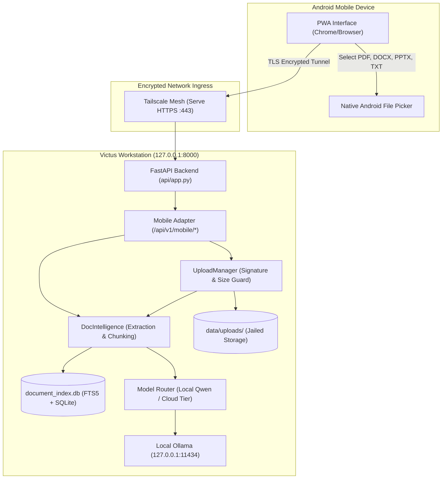

# OPERATION JARVIS — ANDROID DOCUMENT UPLOAD & MOBILE INTELLIGENCE RUNBOOK

**Target System:** HP Victus 15-fa2382TX Autonomous Workstation  
**OS:** Windows 11 Home 64-bit  
**Primary Runtime:** Python 3.14.7 (`C:\Users\Akshay aravind .rv\operation_jarvis\.venv`)  
**Voice Engine Runtime:** Python 3.11.16 (`C:\Users\Akshay aravind .rv\LOCAL_AI_MEMORY\.venv_voice`)  
**Network Security:** Tailscale Private Tailnet Ingress (HTTPS 443 -> 127.0.0.1:8000), Funnel OFF, Ollama 11434 Isolated  
**Date:** November 2026  

---

## 1. System Overview

Operation JARVIS provides an end-to-end, document-grounded AI assistant accessible on Android mobile devices via a Progressive Web App (PWA) over secure Tailscale mesh networking. The system allows users to select documents directly from Android storage, upload them to the workstation, parse and index them into an SQLite FTS5 index, and perform question-answering, summarization, exam preparation, and chapter breakdowns with citations referencing specific pages and slides.



---

## 2. Exact Files Changed and Created

| File | Status | Description |
| :--- | :--- | :--- |
| `core/upload_manager.py` | **NEW** | Upload validation module: magic byte verification, 25MB file limit, 10-file batch limit, path traversal defense via `PathJail`, and collision-resistant unique file storage. |
| `core/doc_intelligence.py` | **MODIFIED** | Added dependency-free XML `.pptx` slide extraction, `get_document()`, `get_document_chunks()`, physical file cleanup on `delete_document()`, and multi-mode `query_documents()` with citation tracking. |
| `core/llm_client.py` | **MODIFIED** | Added clean extraction regexes in `extract_clean_content()` to strip closed and unclosed `<think>...</think>` tags and raw chain-of-thought blocks before transmitting to mobile clients. |
| `core/model_router.py` | **MODIFIED** | Added `workstation` telemetry keyword to `BATMAN_INDICATORS` to route system telemetry requests accurately to the resident Qwen-Batman persona. |
| `api/mobile_adapter.py` | **MODIFIED** | Complete overhaul: added `POST /documents/upload`, `GET /documents`, `DELETE /documents/{doc_id}`, `POST /documents/query`; integrated `/chat` and `/voice` with `orchestrator.execute_objective` and `model_router`; added CSRF origin check; removed 60-token truncation. |
| `api/app.py` | **MODIFIED** | Added top-level route forwarding for `/api/v1/documents/upload` and `/api/v1/documents/query` ensuring desktop and mobile API parity. |
| `static/pwa/index.html` | **MODIFIED** | Added Document Library trigger button with active document badge, Active Document Context bar with prompt chips, Staging tray with progress bar, file attachment button (`accept=".pdf,.docx,.pptx,.txt"`), and Document Library modal. |
| `static/pwa/style.css` | **MODIFIED** | Added mobile-first responsive layout, dark cyan JARVIS theme styling, document staging cards, citation badges, and model tier pills (`LOCAL` vs `CLOUD`). |
| `static/pwa/app.js` | **MODIFIED** | Implemented client-side file staging, removal, FormData upload, document library rendering, active document selection, citation rendering, and telemetry display. |
| `tests/test_document_upload.py` | **NEW** | 16 comprehensive automated tests validating multi-format uploads, magic byte checks, size rejections, path traversal defense, grounded queries, citations, study modes, and document deletion. |
| `tests/test_doc_intelligence.py` | **MODIFIED** | Fixed document-specific test isolation to prevent cross-test match collisions in shared FTS5 database. |

---

## 3. Supported File Formats, Magic Bytes, and Limits

Every uploaded file is subjected to strict verification before touching the disk or database:

| Format | Extension | Magic Bytes / Signature Check | Max Size | Max Batch |
| :--- | :--- | :--- | :--- | :--- |
| **PDF** | `.pdf` | File starts with `%PDF-` (`0x25 0x50 0x44 0x46 0x2D`) | 25 MB | 10 files |
| **DOCX** | `.docx` | PKZip header `PK\x03\x04` (`0x50 0x4B 0x03 0x04`) | 25 MB | 10 files |
| **PPTX** | `.pptx` | PKZip header `PK\x03\x04` (`0x50 0x4B 0x03 0x04`) | 25 MB | 10 files |
| **TXT / MD** | `.txt`, `.md` | Valid UTF-8 / ASCII encoding, strictly zero null bytes (`\x00`) | 25 MB | 10 files |

### Security Safeguards
1. **Magic Byte Enforcement:** A `.exe` or shell script renamed to `document.pdf` is immediately rejected with HTTP 400 (`Invalid file signature`).
2. **Path Traversal Protection:** User filenames are stripped of directories (`os.path.basename`) and checked with `PathJail`. Server-side storage names use `sec_{uuid[:8]}_{safe_filename}`.
3. **No File Overwrite:** Uploads never overwrite existing files; unique identifiers guarantee immutable record creation.
4. **Scanned / Image-Only Documents:** Documents with zero extractable text (scanned PDFs without OCR) are rejected gracefully with a clear message: `"Document contains no extractable text. OCR is not configured."`

---

## 4. Managed Storage Directory

- **Physical Upload Location:** `C:\Users\Akshay aravind .rv\operation_jarvis\data\uploads`
- **Database & Index Location:** `C:\Users\Akshay aravind .rv\operation_jarvis\data\document_index.db`
- **Retention & Cleanup:** When a document is deleted via `DELETE /api/v1/mobile/documents/{doc_id}`, both SQLite chunks, FTS5 index entries, and the physical disk file in `data/uploads/` are safely unlinked.

---

## 5. API Endpoints Reference

All mobile endpoints require the mobile bearer authorization token or session cookie.

### `POST /api/v1/mobile/documents/upload`
Uploads 1 to 10 document files using `multipart/form-data`.
- **Headers:** `Authorization: Bearer <MOBILE_PAIRING_SECRET>`, `X-Requested-With: XMLHttpRequest`
- **Body:** `files`: list of binary file parts
- **Response:**
```json
{
  "ok": true,
  "uploaded_count": 1,
  "failed_count": 0,
  "documents": [
    {
      "doc_id": "doc-a1b2c3d4",
      "filename": "quantum_specs.pdf",
      "total_chunks": 4,
      "total_pages": 2,
      "status": "ingested",
      "size_bytes": 142857
    }
  ],
  "errors": []
}
```

### `GET /api/v1/mobile/documents`
Lists all indexed documents.
- **Response:**
```json
{
  "ok": true,
  "count": 1,
  "documents": [
    {
      "doc_id": "doc-a1b2c3d4",
      "filename": "quantum_specs.pdf",
      "file_type": "pdf",
      "file_size_bytes": 142857,
      "total_pages": 2,
      "total_chunks": 4,
      "ingested_at": "2026-11-07T08:00:00"
    }
  ]
}
```

### `DELETE /api/v1/mobile/documents/{doc_id}`
Deletes the document, cascades chunk deletion, purges FTS5 index, and unlinks physical disk storage.
- **Response:**
```json
{
  "ok": true,
  "doc_id": "doc-a1b2c3d4",
  "deleted": true,
  "file_unlinked": true
}
```

### `POST /api/v1/mobile/documents/query`
Executes grounded question-answering or study generation against indexed documents.
- **Body:**
```json
{
  "query": "What are the core clock frequencies?",
  "doc_ids": ["doc-a1b2c3d4"],
  "task_type": "qa"
}
```
*`task_type` options:* `"qa"`, `"summary"`, `"chapters"`, `"revision_notes"`, `"exam_prep"`
- **Response:**
```json
{
  "ok": true,
  "query": "What are the core clock frequencies?",
  "task_type": "qa",
  "answer": "The core clock frequencies operate at 4.2 GHz Turbo under peak loads [quantum_specs.pdf, Page 1].",
  "citations": [
    {
      "citation": "quantum_specs.pdf, Page 1",
      "filename": "quantum_specs.pdf",
      "page_number": 1,
      "chunk_id": "chk-7f8e9d0a"
    }
  ],
  "sources_used": 1,
  "grounded": true,
  "model_used": "qwen3.5:9b"
}
```

---

## 6. How to Start Ollama and Operation JARVIS

### Step 1: Ensure Ollama is Running
Ollama runs locally on loopback `127.0.0.1:11434`.
In PowerShell:
```powershell
# Check if Ollama is running
Get-Process -Name "ollama*" -ErrorAction SilentlyContinue

# If not running, start Ollama:
Start-Process -FilePath "ollama" -ArgumentList "serve" -WindowStyle Hidden
```

### Step 2: Start Operation JARVIS Backend
Open PowerShell in the `operation_jarvis` directory and activate the primary Python 3.14 virtual environment:
```powershell
cd "C:\Users\Akshay aravind .rv\operation_jarvis"
& ".\.venv\Scripts\Activate.ps1"
uvicorn api.app:app --host 127.0.0.1 --port 8000
```
> [!NOTE]
> The backend strictly binds to `127.0.0.1`. Never bind to `0.0.0.0`!

### Step 3: Frontend Web Assets
> [!IMPORTANT]
> **No NPM command is required!**
> The Android PWA is written in pure vanilla ES6, CSS3, and HTML5 and is mounted directly by FastAPI at `/pwa/` via `StaticFiles(directory="static/pwa", html=True)`. There is no Webpack, Vite, or npm build step needed.

---

## 7. Tailscale Serve Remote Access Configuration

To access JARVIS securely from an Android phone outside or inside the local Wi-Fi:

### Step 1: Verify Tailscale Status & Ingress
Run the automated setup script:
```powershell
powershell -ExecutionPolicy Bypass -File "C:\Users\Akshay aravind .rv\operation_jarvis\scripts\setup_tailscale_serve.ps1"
```

The script performs:
1. Verification that Tailscale Funnel is **OFF** (preventing public internet exposure).
2. Verification that Ollama port 11434 is strictly bound to `127.0.0.1`.
3. Background proxy mapping: `tailscale serve --bg --https 443 http://127.0.0.1:8000`.

### Step 2: Retrieve your Node Address
```powershell
$status = & tailscale status --json | ConvertFrom-Json
$nodeName = $status.Self.DNSName.TrimEnd(".")
Write-Host "PWA URL: https://$nodeName/pwa/"
```

---

## 8. Installing the PWA on Android

1. **Prerequisite:** Install the **Tailscale app** from the Google Play Store on your Android device and log into the same Tailscale account. Connect the VPN switch.
2. Open **Google Chrome** (or Chromium browser) on Android.
3. Navigate to: `https://<your-tailscale-node-name>/pwa/`
4. When prompted, enter your pairing passkey (default in `settings.py` or configured in `.env`).
5. Tap the Chrome three-dot menu `(⋮)` in the top right corner.
6. Select **"Install app"** or **"Add to Home screen"**.
7. Confirm the prompt. The JARVIS icon will appear on your Android home screen and app launcher.
8. Launching JARVIS from the home screen runs it in full-screen standalone mode without URL bars.

### 8.1 Redmi Mobile Testing & Service Worker Cache-Busting Checklist

If testing on an Android device (e.g. Redmi) that previously visited the PWA before this release, Chrome will have cached the older `jarvis-pwa-v1` service worker and app shell. Follow these exact steps to load the updated interface:

1. **Hard Reload / Reset PWA Site Data:**
   - In Chrome on the phone, navigate to `https://<tailscale-node-name>/pwa/`.
   - Tap the tune / settings icon (left of URL bar) $\to$ **Site settings** $\to$ **Delete data & reset permissions** (or tap "Clear & reset").
   - Alternatively, close all open JARVIS tabs, open Chrome settings $\to$ Privacy and security $\to$ Clear browsing data $\to$ Cached images and files.
   - Force-close Chrome by swiping it away from the Android Recents multitasking screen.
2. **Re-open PWA:**
   - Reopen Chrome and navigate to `https://<tailscale-node-name>/pwa/`.
   - Enter your mobile pairing key.
3. **Verify Attachment Icons:**
   - **Top Header Bar:** Notice the new **📎 Paperclip** icon (`#btnHeaderAttach`) located in the header right next to the "Doc Library" button.
   - **Bottom Chat Composer:** Notice the **📎 Paperclip** icon (`#btnAttach`) positioned between the text box and the circular voice mic button.
4. **Verify Document Upload & Citation:**
   - Tap either paperclip icon. The Android system document picker opens.
   - Pick a document (`.pdf`, `.docx`, `.pptx`, or `.txt`).
   - The document appears in the staging tray. Tap **"Upload All"**.
   - The upload progress bar animates to 100%, and a success toast appears.
   - Tap **"Summarize"** or ask a question about the document.
   - Response appears with an exact citation pill (e.g. `[quantum_manual.pdf, Page 1]`).
5. **Verify Reasoning Depth & Telemetry:**
   - Ask a complex technical question (e.g. *"Explain WAL mode in SQLite from first principles"*).
   - Below the assistant message, verify the rich telemetry badge:
     `⚡ qwen3.5:9b · 1240ms · 340 tok · Local Qwen Default`
   - Notice that internal `<think>` reasoning tags are completely hidden while the final explanation remains deep and substantive.

---

## 9. Android Document Upload & Chat Workflow

### A. Uploading Documents
1. Tap the **Paperclip (📎)** attachment button next to the voice mic.
2. The native Android document selector opens. Select one or more files (`.pdf`, `.docx`, `.pptx`, `.txt`).
3. The selected files appear in the **Staging Tray** displaying filename and formatted size.
4. Tap the `×` on any chip to remove an unwanted file, or tap **"Upload All"**.
5. The progress bar indicates upload and background FTS5 indexing. Upon completion, a green toast notification confirms success.

### B. Selecting an Active Document Context
1. Tap the **"Doc Library"** button in the header (or open the Document Library modal).
2. Tap on any indexed document to set it as the **Active Document**.
3. An Active Document pill appears above the composer with four quick-action chips:
   - **Summarize:** Generates an executive summary of the document.
   - **Chapters:** Provides a structured chapter/section breakdown.
   - **Revision Notes:** Extracts high-yield bulleted key concepts.
   - **Exam Prep:** Generates mock exam multiple-choice and conceptual questions.
4. You can also type or speak open-ended queries (e.g., *"What is the warranty period stated in section 3?"*).
5. Responses include exact source citations (e.g., `[contract.pdf, Page 4]`).

---

## 10. Troubleshooting & Operational Diagnostics

| Symptom | Cause | Resolution |
| :--- | :--- | :--- |
| **"Upload failed: Invalid file signature"** | File extension does not match true binary content (e.g. renamed exe). | Ensure file is a genuine PDF, DOCX, PPTX, or UTF-8 text file. |
| **"File exceeds 25 MB limit"** | File is larger than the 25 MB safety ceiling. | Compress the document or split into smaller sections before uploading. |
| **"Document contains no extractable text"** | Document is an image-only scanned PDF. | JARVIS uses text extraction (no OCR engine installed). Run OCR on the PDF beforehand or provide text-based documents. |
| **PWA cannot connect from Android** | Tailscale is disconnected or Workstation is asleep. | Confirm Tailscale VPN is active on Android. The Victus laptop must remain powered on with sleep disabled while acting as host. |
| **"Invalid Pairing Secret"** | Mobile token mismatch. | Re-enter the pairing secret on the PWA login screen matching `MOBILE_PAIRING_SECRET` in `.env`. |
| **Voice synthesis timeout** | Kokoro TTS model generating excessive characters on CPU. | Kept spoken text capped to 200 characters; text response will still provide full depth. |

---

## 11. Workstation Host Continuity Warning

> [!WARNING]
> The HP Victus 15 laptop serves as the physical neural host for JARVIS. If the laptop is put to sleep, shut down, or disconnected from the network, all remote inference, document querying, and PWA operations will halt until the laptop is awake and `uvicorn` is active.
