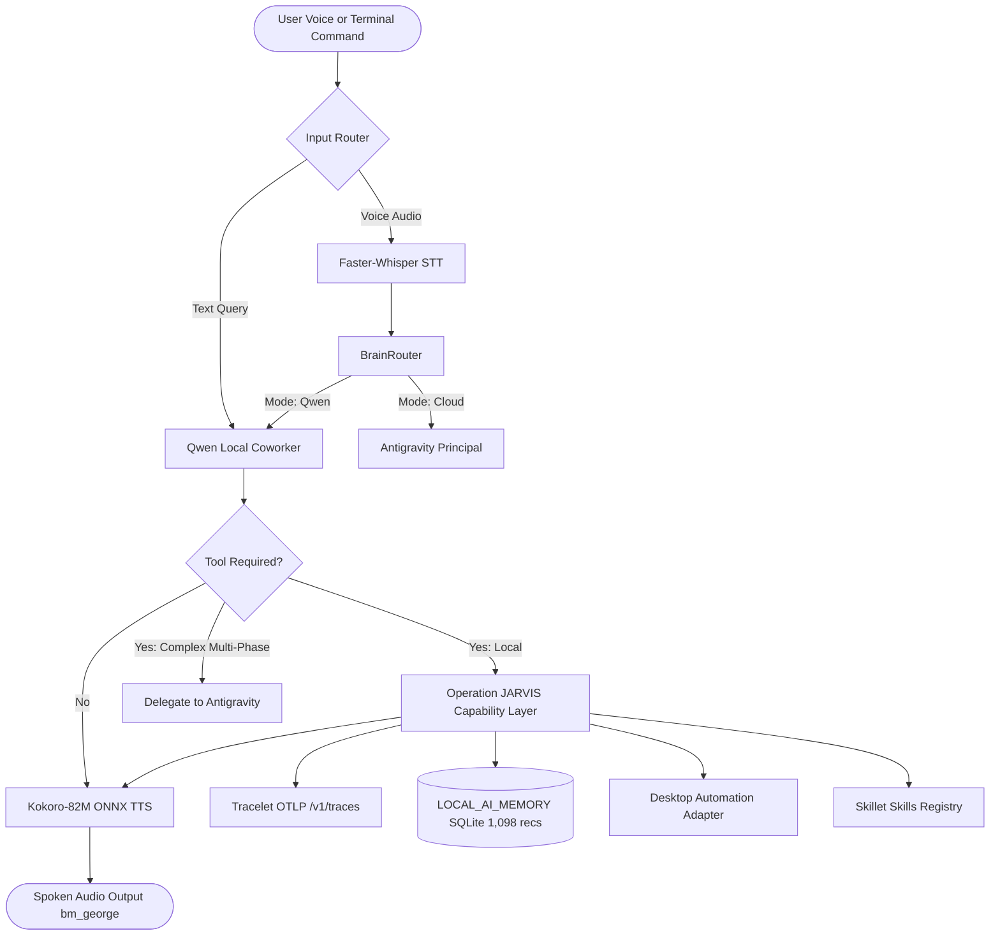

# ANTIGRAVITY / QWEN CAPABILITY MATRIX

**Date:** November 6, 2026  
**Architectural Blueprint:** Operation JARVIS Dual-Ecosystem Orchestration  

---

## 1. System Role Definition

- **Google Antigravity:** Principal Orchestrator. Handles complex multi-turn plans, broad subagent delegation, deep codebase refactoring, multi-file edits, and system command execution.
- **Qwen-Batman (`qwen3.5:9b`):** Local AI Coworker. Handles instant local assistance, fast tool invocation, personal SQLite memory retrieval and storage, and desktop operations without cloud exposure.
- **Qwen Voice Interface:** Voice Extension to Qwen/JARVIS capabilities. Transcribes user speech via Faster-Whisper, routes commands via `BrainRouter`, executes tools, and synthesizes responses using Kokoro-82M ONNX INT8 (`bm_george`).
- **Operation JARVIS:** Shared Orchestration & Tool Execution Layer. Manages tool execution, concurrency locks, audit logging, Tracelet OTLP tracing, and capability registry.
- **LOCAL_AI_MEMORY:** Primary Shared SQLite/FTS5 Database (1,098 records) accessible concurrently across all interfaces.

---

## 2. Exhaustive Capability Matrix

| Capability Category | Exact Tool / Feature | Google Antigravity | Qwen-Batman Coworker | Qwen Voice (Kokoro) | Operation JARVIS Layer |
|---|---|---|---|---|---|
| **Skill Discovery** | `unslop` (Frontend Design) | Native via `SkillRegistry` | Discovered in shared plugins | Spoken advice / principles | Shared plugins folder |
| | `changelog` (Git Changelog) | Native via `SkillRegistry` | Discovered via `skillet_list` | Spoken skill status | Pinned in skillet.lock |
| | `skillet_search` / `list` | stdio MCP server | Native in `ToolRegistry` | Spoken search results | Exposed in `capability_registry.py` |
| | `skillet_install` | CLI / MCP server | Native in `ToolRegistry` | Blocked (requires confirmation)| Guarded against destructive edits |
| **Execution Tracing** | Tracelet OTLP Collector | Emitted via JARVIS hook | Emitted on tool run | Emitted on voice tool run | Emits JSON spans to `127.0.0.1:4318` |
| | Live Web Dashboard | `http://127.0.0.1:4321` | `http://127.0.0.1:4321` | N/A (Visual DevTools) | Standalone background daemon |
| **Shared Memory** | FTS5 BM25 Search | `mcp_local-memory_memory_search`| `memory_search` tool | Spoken memory recall | `LOCAL_AI_MEMORY/memory.db` |
| | Memory Store / Update | `mcp_local-memory_memory_store` | `memory_store` tool | Spoken memory ingestion | ACID SQLite transactions |
| **Desktop Automation** | Desktop App Listing | Workspace tool | `desktop("list-apps")` | Spoken app list | Direct PowerShell / UI query |
| | Desktop Window Focus | Workspace tool | `desktop("focus", ...)` | Spoken focus action | Guarded window automation |
| **Browser Automation** | Chrome DevTools | MCP tool suite | Direct adapter | Delegated to Antigravity | Chrome DevTools MCP |
| | Playwright Automation | MCP tool suite | Direct adapter | Delegated to Antigravity | Playwright MCP |
| **Security & Safety** | Prompt Injection Defense | Inherent system prompt | Local refusal (100% defense) | Local refusal (100% defense)| AgentDojo tested & verified |
| | Workstation Access Policy | User-confirmed commands | Sandboxed tools only | Confirmation required | Hardened parameter validation |

---

## 3. Delegation & Routing Protocol

