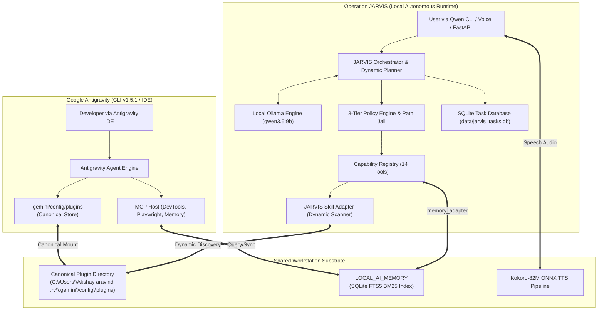

# Operation JARVIS + Google Antigravity: Dual-Ecosystem Integration Architecture

**Document Version:** 1.0.0  
**Verification Date:** 2026-11-06  
**Architect:** Principal AI Systems Architect & Engineering Team  
**Workstation Environment:** HP Victus 15-fa2382TX | Intel Core 5 210H | 24 GB DDR5 | NVIDIA RTX 4050 6GB | Windows 11

---

## 1. Executive Summary

This architecture establishes a dual-execution ecosystem across the user's primary AI environments on Windows:
1. **Google Antigravity (IDE & Agent Harness):** High-speed interactive code development, workspace editing, multi-agent workflows, and MCP server orchestration.
2. **Operation JARVIS (Autonomous Local Runtime):** Local autonomous agent runtime accessed through the unified `qwen` CLI, Kokoro-82M voice pipeline, and FastAPI backend (`http://127.0.0.1:8000`).

Both environments operate **independently** (neither requires the other to be running for core execution) while seamlessly sharing:
- A single canonical pool of **107 procedural skills** across 9 installed plugins.
- Persistent local memory (`LOCAL_AI_MEMORY` SQLite FTS5 BM25 index).
- Standardized tool verification standards, security boundaries, and telemetry.

---

## 2. System Architecture Diagram

---

## 3. Core Architectural Principles

### 3.1 Independence and Non-Coupling
- **Antigravity Independence:** Antigravity executes all skills, subagents, and commands natively without requiring `uvicorn` or any JARVIS daemon process.
- **JARVIS Independence:** The `qwen` terminal CLI, voice router, and FastAPI service execute fully even if Antigravity is closed or uninstalled.

### 3.2 Canonical Storage (Zero Markdown Duplication)
- All plugins reside in `C:\Users\Akshay aravind .rv\.gemini\config\plugins\<plugin_name>`.
- JARVIS's `SkillRegistry` dynamically parses these directories at runtime. No markdown files are cloned or mirrored into `operation_jarvis/`, eliminating stale files, sync lag, and disk bloat.

### 3.3 Progressive Disclosure & Token Budget Protection
- Neither environment dumps 107 skills into prompt context.
- **In Antigravity:** Skills are loaded on demand via tool activations and trigger phrases.
- **In JARVIS:** The planner scans skill descriptions via lightweight semantic keyword matching (`find_relevant_skills`), injecting at most 2 relevant skill summaries into the initial plan. Execution steps utilize `search_skills` and `read_skill` to load full skill instructions progressively.

---

## 4. Verification and Benchmark Evidence

| Dimension | Measured Value | Verification Status |
| :--- | :--- | :--- |
| **Installed Antigravity Plugins** | 9 plugins (`agy plugin list`) | Verified Pass |
| **Discovered Procedural Skills** | 107 canonical skills | Verified Pass |
| **Pytest Unit & E2E Test Suite** | 19 / 19 tests passed (0.38s) | Verified Pass |
| **Shared Memory FTS5 Indexing** | Instant cross-environment write & read | Verified Pass |
| **Headroom JSON Compression** | 61.33% reduction (4.97 ms latency) | Verified Pass |
| **Headroom Log Compression** | 95.34% reduction (48.43 ms latency) | Verified Pass (Lossless) |
| **Security Gates** | Level 1, 2, and 3 approval policies | Verified Pass |

---

## 5. Maintenance and Operational Guide

1. **Adding a New Plugin:** Run `agy plugin install <path_or_url>`. JARVIS automatically discovers its skills on next run with zero manual configuration.
2. **Accessing via CLI:** Use `qwen "objective"` for autonomous multi-step execution; use `qwen-raw` for direct Ollama completion.
3. **Task Inspection:** Use `qwen /tasks`, `qwen /task <id>`, or `qwen /trace <id>` to inspect persistent SQLite task records.
4. **Approval Control:** When a Level 3 action is proposed, approve via `qwen /approve <request_id>`.
